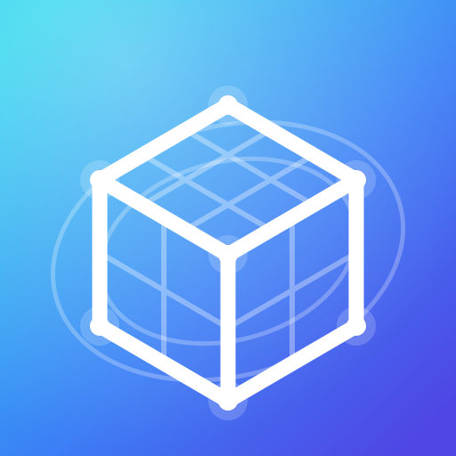

# halo-plugin-3d



[](https://github.com/FFeng123/halo-plugin-3d/actions/workflows/ci.yaml)
[](https://github.com/FFeng123/halo-plugin-3d/blob/main/LICENSE)

Halo 博客框架 **2.21.7** 的 3D 模型插件：在文章中插入并渲染 3D 模型，基于 **Three.js**，支持 **亮色 / 暗色**主题。

| 能力 | 说明 |
| --- | --- |
| 模型格式 | `.obj`（可搭配 `.mtl` 材质）、`.fbx`、`.glb` / `.gltf`（含 Draco / Meshopt / KTX2 压缩） |
| 选择方式 | 在编辑器里从「附件」中选择，支持搜索、翻页与**直接上传**（走 Halo 公开的附件上传接口） |
| 渲染 | Three.js（WebGL），支持鼠标旋转 / 缩放、自动旋转 |
| 主题 | 自动跟随站点亮/暗色，也可对单个模型强制指定 |
| 背景 | 透明 / 纯色 / 渐变三种样式 |
| 网格 | 可单独开关地面的参考网格 |
| 可配置 | 编辑器内可视化配置：自动旋转、网格显示、能否手动拖动、主题、背景、宽高 |

---

## 一、安装

1. 下载插件包：
   - GitHub Releases：访问 [Releases](https://github.com/FFeng123/halo-plugin-3d/releases) 下载 Assets 中的 JAR 文件；
   - 或自行构建：在插件目录下执行打包（见「开发」一节），得到 `dist/PluginThreeD-<版本>.jar`；
2. 进入 Halo 控制台 →「插件管理」→「插件商店 / 安装插件」→「上传插件」；
3. 选择 jar 上传，安装完成后**启用**插件。

> 插件要求 Halo `>= 2.21.7`（`plugin.yaml` 中的 `spec.requires`）。
> 安装后插件图标会显示在「插件管理」列表与插件详情页（头像位）。

### ⚠️ 升级必读：改了前端一定要升版本号

Halo 注入插件前端资源时会带上 `plugin.yaml` 里的版本参数
（源码 `PluginReconciler.resolveStaticResources()`）：

```
/plugins/PluginThreeD/assets/console/main.js?version=<spec.version>
/plugins/PluginThreeD/assets/console/style.css?version=<spec.version>
```

**版本号不变 ⇒ 资源地址不变 ⇒ 浏览器会继续用缓存里的旧 `main.js`。**
这时会出现「jar 明明换了、界面却一点没变」的假象（改了半天像是完全没生效）。

所以：**每次改动前端代码，都要把 `src/main/resources/plugin.yaml` 的 `spec.version`
提升一下**（例如 `1.1.0` → `1.1.1`），再重新打包。
`npm run package` 会在「版本号没变但内容变了」时打印醒目警告，并输出本次的实际资源地址，便于核对。

安装/升级后建议再 `Ctrl + F5` 强刷一次控制台。

## 二、使用

### 1. 准备模型文件

在「附件」里上传模型文件即可。推荐做法：

- **GLB**：单个文件，材质贴图都打包在里面，最省事，兼容性最好；
- **OBJ + MTL + 贴图**：把 `.obj`、`.mtl` 以及 `.mtl` 中引用的贴图（如 `map_Kd wood.png`）**一起上传到附件**。
  MTL 中写的是相对路径，运行时以 MTL 文件的地址为基准解析，因此同一批上传的贴图能被正确找到；
- **FBX**：单个文件，外部贴图同样建议一起上传。

#### 关于压缩过的 glTF / GLB

很多导出的 `.glb` / `.gltf` 是**压缩**的，直接加载会报错（典型的是
`THREE.GLTFLoader: No DRACOLoader instance provided.`）。运行时已经内置了三种常见压缩的解码器：

| 扩展 | 说明 |
| --- | --- |
| `KHR_draco_mesh_compression` | Draco 网格压缩（Blender 导出 glTF 时可勾选） |
| `EXT_meshopt_compression` | Meshopt 压缩（gltfpack 常用） |
| `KHR_texture_basisu` | Basis / KTX2 压缩纹理 |

解码器文件（`draco/`、`basis/`）会随插件一起发布到
`/plugins/PluginThreeD/assets/console/` 下，运行时按同目录自动查找，
**不需要额外配置，也不依赖 CDN**。

> ⚠ 如果某个模型仍然加载失败，错误信息会显示在模型区域里（附「在新窗口打开模型文件」链接），
> 可以先直接打开原文件确认模型本身是否完好。

#### ⚠️ 附件存储策略：上传 `.glb` / `.obj` 被拒时必看

Halo 的**本地存储策略**默认带一条「文件类型限制」。只要它在生效，
上传模型就可能被拒——**这不是插件的问题，是 Halo 的策略在拦**。

**症状**：在插件的「选择模型文件」面板里点「上传文件」，或到控制台「附件」里上传，
提示 `文件类型 xxx 与文件扩展名不匹配，上传被拒绝`（HTTP 415）
或 `不支持上传 xxx 类型的文件`（HTTP 415）。

**改法（一步到位）**：

1. 控制台 → **内容 → 附件**；
2. 右上角点 **「存储策略」** 按钮；
3. 选中 **「本地存储」** → 点编辑；
4. 把 **「文件类型限制」里的选项全部取消勾选（留空）** → 保存。

> 「文件类型限制」清空后，Halo 会**整段跳过**文件类型校验，
> 任何扩展名（`.glb` / `.gltf` / `.obj` / `.mtl` / `.fbx`）都能正常上传。

**为什么不能只勾「无限制(ALL)」**：

Halo 的校验分两步（源码 `LocalAttachmentUploadHandler.validateFile`）：

1. `FileTypeDetectUtils.isValidExtensionForMime()`：用 Apache Tika 检测文件真实类型，
   再反查该类型对应的**规范扩展名**，跟文件实际扩展名比对；
2. `FileCategoryMatcher`：文件类型必须落在允许的类别里
   （`ALL` / `IMAGE` / `SVG` / `VIDEO` / `AUDIO` / `DOCUMENT` / `ARCHIVE`，只能勾这些，无法手填 MIME）。

Tika 的内置映射里 **`.glb` → `model/gltf-binary`、`.fbx` → `application/x-fbx`** 是有的，
所以这两个格式在勾了「无限制」时能通过第 1 步；
但 **`.gltf` / `.obj` / `.mtl` Tika 不认识**，第 1 步就会以 `fileTypeNotMatch` 被拒——
**哪怕勾了「无限制」也一样**。所以唯一稳妥的做法就是把限制清空。

> 另外，Halo 的「从 URL 上传」（`uploadFromUrl`）走的是同一条上传链路，
> 同样会被这条策略拦住，换上传方式没有用。

插件在上传被拒时，会直接把上面这段路径和原因显示在面板里，不用去猜。

### 2. 在文章中插入

编辑器里任选一种方式：

- 工具箱「+」→ **3D 模型**；
- 输入斜杠命令 `/3d`、`/3D 模型` 等关键字 → 选择「3D 模型」；
- 选中已插入的模型 → 悬浮菜单里可以「更换模型」。

点击「3D 模型」后，模型节点会**立刻插入到光标处**，节点里直接出现
「选择模型文件」面板（列出附件中的模型文件，可按文件名搜索、翻页）。

> 这个面板是**节点视图的一部分，不是弹窗**——它跟正文一起渲染，
> 不依赖任何浮层 / 遮罩 / 第三方弹窗样式，所以不存在"点了没反应 / 面板显示不出来"的问题。
> 选完文件后面板自动收起，模型就地渲染；想换文件点右上角齿轮 →「更换」。

### 3. 调整展示效果

**方式一：悬浮菜单（快捷切换）**

选中模型后，悬浮菜单提供：

| 按钮 | 作用 |
| --- | --- |
| 更换模型 | 重新从附件中选择 |
| 设置 | 展开完整的配置面板（见下） |
| 主题 | 在「跟随站点 → 亮色 → 暗色」之间循环 |
| 自动旋转 | 开 / 关 |
| 网格 | 显示 / 隐藏地面参考网格 |
| 拖动 | 允许 / 禁止手动拖动与缩放 |
| 高度 | 在 320 / 420 / 560 / 680px 之间循环 |
| 删除 | 删除该模型 |

**方式二：设置面板（完整配置）**

点悬浮菜单的「设置」会在气泡菜单下方展开设置面板；
鼠标移到模型上时点右上角的齿轮按钮，则是在模型下方就地展开同一套面板：

| 分组 | 可配置项 |
| --- | --- |
| 模型 | 查看当前文件名、「更换」 |
| 外观 | 主题（跟随站点 / 亮色 / 暗色）、背景（透明 / 纯色 / 渐变）、显示网格 |
| 交互 | 自动旋转、允许手动拖动 / 缩放 |
| 尺寸 | 宽度预设（100% / 640 / 800 / 1000px）或自定义、高度预设（320 / 420 / 560 / 680px）或自定义 |

面板里的改动**会实时同步到编辑器中的预览**（不用保存即可看到效果），点「完成」收起面板。

## 三、亮色 / 暗色主题

每个模型块都有一个 `theme` 属性：

- `auto`（默认）：**跟随站点主题**，运行时会实时监听站点主题变化并自动切换；
- `light`：固定使用亮色灯光与背景；
- `dark`：固定使用暗色灯光与背景。

运行时判定站点主题的顺序：

1. `<html>` / `<body>` 上的主题属性：`data-theme`、`data-appearance`、`data-color-mode`、`data-mode`、`data-bs-theme`、`data-color-scheme`
   （值为 `dark` / `night` / `black` / `dim` 时判定为暗色）；
2. `<html>` / `<body>` 上的 `dark` / `light` class（Tailwind `darkMode: "class"` 约定）；
3. 系统的 `prefers-color-scheme`。

以上任一项变化都会通过 `MutationObserver` 被监听，切换站点主题时模型会实时跟随。

> Halo 控制台自身没有暗色模式，因此编辑器里的预览默认按亮色渲染；把某个模型显式设置为「暗色」即可预览暗色效果。

## 四、文章里保存的内容

插入后文章中会写入如下 HTML：

```html
<div class="halo-3d-model"
     data-halo-3d-model="true"
     data-src="/upload/2026/11/model.glb"
     data-mtl-src=""
     data-name="model.glb"
     data-width="100%"
     data-height="420px"
     data-theme="auto"
     data-autorotate="true"
     data-background="solid"
     data-grid="true"
     data-controls="true"
     style="position:relative;display:block;width:100%;height:420px;overflow:hidden;margin:1rem auto;">
  <div class="halo-3d-fallback" style="display:flex;...">
    <span style="font-weight:600;color:#6b7280;">3D 模型：model.glb</span>
    <span style="font-size:12px;">（若长时间显示此提示，请确认已安装并启用 3D 模型插件）</span>
  </div>
  <script src="/plugins/PluginThreeD/assets/console/halo-3d-runtime.js" defer="defer" data-halo-3d-runtime="true"></script>
</div>
```

各属性含义：

| 属性 | 取值 | 说明 |
| --- | --- | --- |
| `data-src` | URL | 模型文件地址（附件 permalink） |
| `data-mtl-src` | URL | OBJ 搭配的 MTL 材质地址，没有则为空 |
| `data-name` | 文本 | 模型文件名，用于展示 |
| `data-width` | CSS 长度 | 展示宽度 |
| `data-height` | CSS 长度 | 展示高度 |
| `data-theme` | `auto` / `light` / `dark` | 配色方案 |
| `data-autorotate` | `true` / `false` | 是否自动旋转 |
| `data-background` | `none` / `solid` / `gradient` | 背景样式（透明 / 纯色 / 渐变） |
| `data-grid` | `true` / `false` | 是否显示地面网格 |
| `data-controls` | `true` / `false` | 是否允许手动拖动 / 缩放 |

> **兼容旧内容**：早期版本用 `data-background="grid"` 同时表达「网格」和「背景」。
> 现在会自动把 `grid` 解析成「纯色背景 + 显示网格」，
> 而 `data-background="none"` 且没有 `data-grid` 的旧内容仍然不显示网格。

渲染脚本被放在 `div` 内部，这样**重新编辑文章时不会丢失**（编辑器会把它当作模型节点的一部分保存回去）。

### 一篇文章里放多个模型

每个模型块都会带一个 `<script src="halo-3d-runtime.js">`，但**运行时只会初始化一次**：

- 运行时 bundle 在 IIFE 函数体最前面带一段幂等守卫
  （`vite.runtime.config.ts` 的 `output.intro`），发现已初始化过就直接返回，
  因此 **three.js 不会被重复实例化**（这是之前控制台里出现「重复加载」类警告的根因）；
- 初始化完成后，文章里其余重复的 `<script data-halo-3d-runtime>` 会被移除，
  DOM 里只剩一个运行时入口；
- 运行时同时用 `MutationObserver` 监听页面变化，
  之后**动态插入**的模型块（比如主题做了局部刷新）也会被自动挂载。

### 卸载插件之后

模型块里内嵌了一个**样式全部内联**的占位元素（`.halo-3d-fallback`）：

- 插件正常时：运行时挂载成功后它会被移除，读者看到的就是 3D 模型；
- 插件被卸载 / 未启用时：运行时脚本 404，占位元素留在原地，
  读者看到的是「3D 模型：xxx」这样一块**有说明的占位框**，
  而不是原来那种固定 420px 的空白大框。

> 已经发布的老文章里存的是旧版 HTML（没有占位元素），
> 在编辑器里重新保存一次就会补上。

### 主题要求

文章正文需要被**原样输出为 HTML**（绝大多数 Halo 主题都是这样做的）。如果你的主题对正文做了过滤，
导致 `script` 被剥离，可以把下面这行加到主题的 `footer`（或任意自定义模板）里，运行时同样会自动初始化页面中所有模型：

```html
<script src="/plugins/PluginThreeD/assets/console/halo-3d-runtime.js"></script>
```

## 五、开发

### 目录结构

```
halo-plugin-3d/
├── src/main/resources/
│   ├── plugin.yaml            # 插件清单（metadata / spec / logo / 作者 / 许可证…）
│   ├── logo.svg               # 插件图标（512×512，Halo 按 /plugins/PluginThreeD/assets/logo.svg 提供）
│   └── console/               # 构建产物（main.js / style.css / halo-3d-runtime.js / draco / basis）
├── scripts/
│   ├── package-plugin.mjs     # 打包脚本（产出 dist/PluginThreeD-<版本>.jar）
│   ├── validate-manifest.mjs  # 按 Halo PluginSpec 校验 plugin.yaml
│   └── gen-logo.mjs           # 插件图标生成脚本（几何精确，可重复执行）
├── test/                      # 本地测试页（运行时 / 编辑器 / 格式 / 图标）
├── .github/workflows/         # CI / CD
├── LICENSE / OWNERS / .editorconfig
└── ui/                        # 前端工程
    ├── src/
    │   ├── index.ts           # 插件入口（注册编辑器扩展点）
    │   ├── tiptap/            # Tiptap 节点扩展
    │   ├── components/        # 节点视图、设置面板、图标
    │   ├── utils/             # 附件选择封装、插入/更换动作、节点定位
    │   ├── runtime/           # 公开站点运行时（three.js）
    │   ├── dev/               # 仅本地测试用，不会进入产物
    │   └── ...
    ├── vite.config.ts         # 控制台包
    ├── vite.runtime.config.ts # 公开站运行时包
    └── vite.harness.config.ts # 本地测试包（模拟 Halo 控制台）
```

### 构建与打包

```bash
cd ui
npm install
npm run build        # 同时构建控制台包与公开站运行时
npm run type-check   # 类型检查
npm run validate     # 按 Halo PluginSpec 校验 plugin.yaml（字段、SemVer、logo 路径…）

cd ..
npm --prefix ui run package   # 生成 dist/PluginThreeD-1.3.1.jar
```

### 插件图标

图标是 `src/main/resources/logo.svg`（512×512 满幅方图，遵循 Halo 官方插件 logo 规范：
渐变底 + 白色线性图形）。`plugin.yaml` 里只写相对路径：

```yaml
spec:
  logo: logo.svg
```

Halo 会把它解析成 `/plugins/PluginThreeD/assets/logo.svg?version=<spec.version>`，
显示在「插件管理」列表、插件详情页头像位、全局搜索结果和系统概览的插件条目里。

图形由 `scripts/gen-logo.mjs` **按几何精确生成**（等轴测立方体 + 面内网格 + 顶点节点 + 轨道环），
改配色或尺寸直接改脚本里的常量再重跑即可：

```bash
node scripts/gen-logo.mjs
```

> 调整后记得同步升 `plugin.yaml` 的 `spec.version`——否则 `logo.svg?version=<旧版本>`
> 的地址不变，浏览器会继续用缓存里的旧图标。

### 关键实现说明

- **编辑器扩展**：通过 `default:editor:extension:create` 扩展点注入 Tiptap 节点，
  工具箱 / 斜杠命令 / 悬浮菜单分别对应 `getToolboxItems`、`getCommandMenuItems`、`getBubbleMenu`；
- **附件选择：面板内联在节点里，不用弹窗**。原因有两条，都来自官方文档与实测：
  1. Halo 官方文档里 `ExtensionOptions` 只公开 5 个扩展点
     （toolbar / commandMenu / bubbleMenu / toolbox / draggable），
     **没有任何"打开附件选择器"的公开 API**；
     `editor.commands.openAttachmentSelector` 是控制台 `DefaultEditor.vue`
     内部的私有命令，不属于插件契约；
  2. 实测在控制台里调用它并不会把选择器渲染出来。
  ⇒ 于是改成官方示例插件（`plugin-text-diagram`）的范式：
  **点击工具箱后同步 `insertContent` 插入节点**，后续交互全部在节点视图内完成。
  这样点击必定有可见结果，也不再有"等待某个弹窗出现才继续"的死等；
- **附件列表直连 Halo 公开 API**：`consoleApiClient.storage.attachment.searchAttachments`
  （和 Halo 自己的附件选择器同一个接口）。查询时**不传 `accepts`**——
  服务端是按 `spec.mediaType` 前缀匹配的，而 `.obj` / `.mtl` / `.fbx`
  浏览器上报的媒体类型并不稳定（多半是 `application/octet-stream`），
  交给服务端过滤反而会把要的文件滤掉；统一取回来再按**文件扩展名**本地精确筛选；
- **设置面板也不用弹窗**：Halo 的悬浮菜单按钮 `action` 支持**返回一个组件**，
  返回后组件会渲染在气泡菜单的下拉层里
  （Halo 源码：`ui/packages/editor/src/components/bubble/BubbleItem.vue`）。
  插件的完整设置面板就走这条路；模型右上角的齿轮按钮则是在节点视图里就地展开同一套面板；
- **媒体类型过滤**：`accepts` 同时要满足 Halo 两端的匹配规则——
  服务端是**前缀匹配**（`model/*` → `model/`），客户端是**正则匹配**（`model/*` → `model/.*`），
  因此 `model/*` 两边都成立；`.obj` / `.mtl` / `.fbx` 浏览器会报 `application/octet-stream`，一并带上；
  选中后还会再按**文件扩展名**精确校验一次，拦住选错的文件；
- **运行时体积**：three.js 及其加载器只打包在 `halo-3d-runtime.js` 中（gzip 约 178 KB），
  控制台插件包本身只有约 19 KB，编辑器预览时按需从 `/plugins/PluginThreeD/assets/console/` 加载运行时；
- **性能**：视口外的模型自动暂停渲染，`ResizeObserver` 跟随容器尺寸，`OrbitControls` 带阻尼；
  改属性时走 `runtime.mount()` 的热更新路径，不会重新下载模型。

### 本地测试

```bash
node test/server.mjs 4321
# 浏览器打开 http://127.0.0.1:4321/          → 公开站运行时（OBJ/MTL、亮暗主题、网格、旧内容兼容）
# 浏览器打开 http://127.0.0.1:4321/formats.html → 模型格式支持（含 Draco 压缩的 glTF）
# 浏览器打开 http://127.0.0.1:4321/editor.html  → 编辑器集成测试
# 浏览器打开 http://127.0.0.1:4321/logo.html    → 插件图标在控制台各头像尺寸下的视觉验收
```

> `test/server.mjs` 把 `/plugins/PluginThreeD/assets/*` 映射到 `src/main/resources/*`，
> 与 Halo 真实路由（`/plugins/{name}/assets/{*resource}` → 插件 jar 根目录）保持一致，
> 所以 `logo.html` 里看到的就是 Halo 里实际会加载的那张图。

`test/editor.html` 是一个**集成测试**，不是界面预览：

- 加载 Halo **真实的** `@halo-dev/richtext-editor`（真正的 Tiptap 编辑器）
  与 `@halo-dev/components`；
- 用 Halo 自己的 `RichTextEditor` 组件把编辑器挂进 Vue 应用（和 `DefaultEditor.vue` 结构一致）；
- 用 Halo 自己的 `RichTextEditor` 组件把编辑器挂进 Vue 应用
  （和 `DefaultEditor.vue` 的结构一致，节点视图依赖组件树上下文）；
- 走一遍「点工具箱 → 节点同步插入 → 节点内出现选择面板 → 附件接口返回数据 → 点文件写入属性 → 画布渲染」的完整链路，
  最后输出 26 项断言的结果。

> ⚠ 上一版的测试页在 HTML 里**手写了一份 `.modal-wrapper` 的 CSS**，
> 于是「弹窗显示正常」完全是那页自己造出来的假象，真实控制台里的问题一个都测不出来。
> 这一版已经彻底移除所有自写的弹窗 CSS。

测试用模型文件在 `test/fixtures/`（`cube.obj` + `cube.mtl`），公开站运行时测试用的是同一份文件。

测试包由 `ui/vite.harness.config.ts` 构建：

```bash
cd ui && npx vite build --config vite.harness.config.ts
```

## 六、已知限制与排错

- 模型文件解析失败（例如 OBJ 索引越界导致顶点出现 NaN）时会提示「模型文件解析失败」，此时请检查模型文件本身；
- FBX / GLTF 中引用**外部**贴图时，需要把贴图也上传到附件并保证相对路径可解析（贴图打包进文件的 GLB 不受影响）；
- 运行时地址与解码器目录会按「加载它的那个 script 的 src」自动推断，站点部署在子路径下也能正确找到；
- 模型选择面板会调用 Halo 的附件查询接口，因此需要有附件的查看权限；上传文件请到后台「附件」页面操作；
  
  - 材质（`.mtl`）是可选步骤：点齿轮 →「选择材质文件（.mtl）」，不选也能正常显示（只是没有自定义材质）；
- **如果点了「插入 3D 模型」还是没反应**：本版本起所有失败路径都会弹 `Toast` 错误提示，
  同时浏览器控制台（DevTools → Console）会打印 `[halo-plugin-3d]` 开头的错误。
  把这段日志反馈出来即可定位——控制台侧的任何异常都不会再被静默吞掉。

## 七、许可证

[GPL-3.0](./LICENSE)
